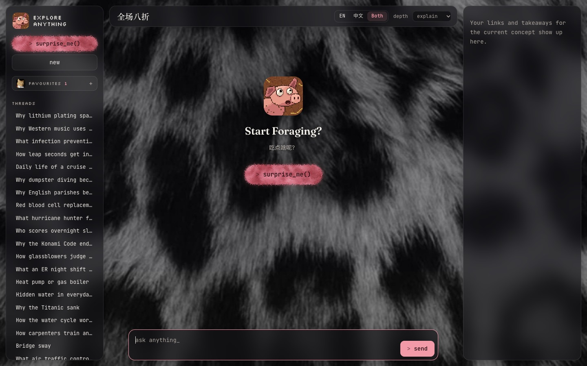
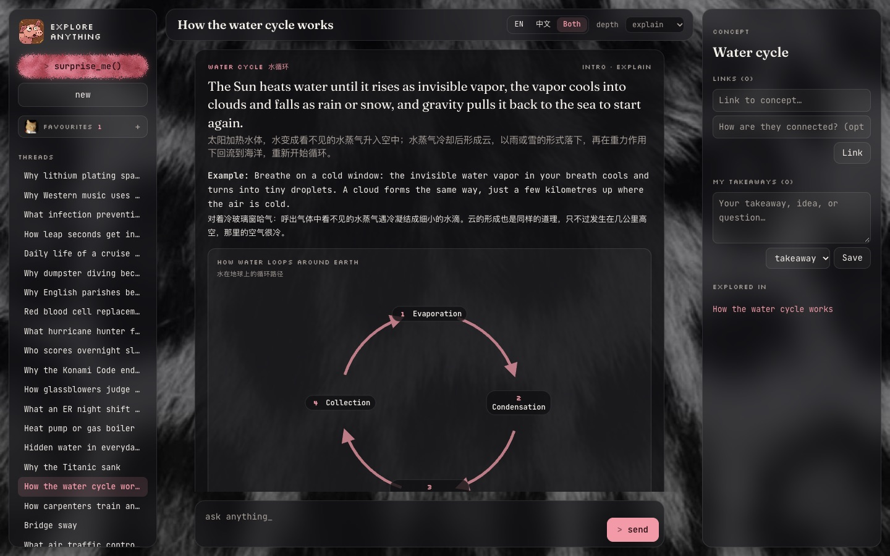
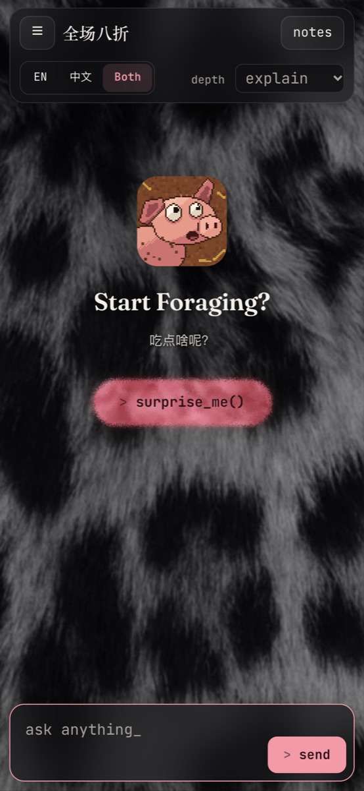
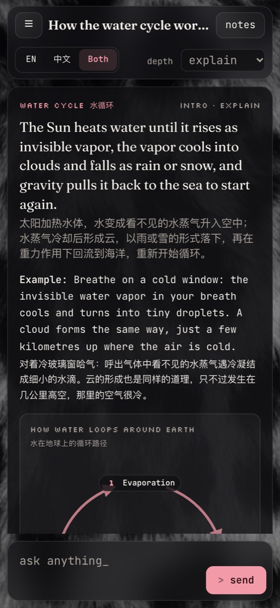

<p align="center">
  
</p>

<h1 align="center">explore-anything</h1>

<p align="center">
  <em>Start Foraging? · 吃点啥呢？</em>
</p>

A chat-first curiosity engine: explore concepts through hook cards, connect them yourself, and keep
your own takeaways. See [docs/ARCHITECTURE.md](docs/ARCHITECTURE.md) and [docs/P0_SPEC.md](docs/P0_SPEC.md).

## Demo



Press **surprise_me()** and it picks something worth exploring, or ask anything. Every answer is a hook
card, in English, Chinese or both, often with a diagram drawn for it:



<table>
  <tr>
    <td width="50%"></td>
    <td width="50%"></td>
  </tr>
  <tr>
    <td align="center"><sub>On a phone, as a home-screen app</sub></td>
    <td align="center"><sub>Cards read the same on a small screen</sub></td>
  </tr>
</table>

Under each card: the coffee cat saves it to **favourites** (a pixel heart fills in), the wide-eyed kitten
adds a **takeaway**, and on a surprise pick the sleepy fish says **not interested**, then asks whether you
want a new one or to stay.

## Quickstart

Needs Docker Desktop (running) and [uv](https://docs.astral.sh/uv/).

```bash
cp .env.example .env      # add ANTHROPIC_API_KEY (needed from M2)
make dev                  # Postgres in Docker → migrations → API + page on http://localhost:8000
```

API docs: http://localhost:8000/docs

| Command | What it does |
|---|---|
| `make dev` | Start the DB, apply migrations, run the API with reload |
| `make test` | Run the test suite (uses the separate `explore_test` database) |
| `make lint` / `make fmt` | Ruff checks / auto-fix and format |
| `make migration m="..."` | Autogenerate a migration from model changes |
| `make psql` | Open psql on the dev database |
| `make db-reset` | Delete the DB volume (all local data) |

## Use it on your phone or another computer

On your home Wi-Fi, with this Mac on and awake:

1. Set `APP_PASSWORD` in `.env`. `make lan` refuses to start without it, since anyone on the Wi-Fi could
   otherwise open the app and spend your API credit.
2. Run `make lan` (instead of `make dev`). It prints the address to open, e.g. `http://my-mac.local:8000`.
   The first time, macOS may ask whether Python can accept incoming connections: allow it.
3. Open that address on the phone and sign in once (the session lasts a year; changing the password
   signs every device out).
4. Install it: on iPhone, Share → **Add to Home Screen** (opens full screen, like an app). On Android,
   Chrome menu → **Add to Home screen** (over plain http it opens as a Chrome tab rather than full screen).

On a phone the thread list is behind ☰ and the concept's links and takeaways behind **Notes**.
The database only listens on this Mac, never the network.

## API costs and limits

Every Anthropic API call is recorded with its cost in the `api_call` table. The sidebar shows today's
and this month's spend.

- **App budgets:** `DAILY_BUDGET_USD` / `MONTHLY_BUDGET_USD` in `.env` (defaults $2 / $20; 0 = no limit).
  Once one is reached, new turns and Surprise me are refused with a clear message, and the page warns
  from 80%. Days and months follow your computer's clock. Prices live in `apps/api/app/llm/pricing.py`.
- **Evals:** `evals/run_cards.py` shows an estimate and asks before spending, stops at `--max-cost`
  (default $5), and records its calls as `eval`/`judge`, which don't count toward the app budgets.
- **Hard ceiling:** set a monthly spend limit on the API key's workspace at console.anthropic.com.
  The app's limits are a convenience; the console's is the guarantee.
- **Tests never call the API:** the test setup forces a dummy key and fakes every model.

## Layout

```
apps/api/        FastAPI backend + the minimal static page (app/static)
  app/models.py  three layers: threads/messages · concepts/links · takeaways
  alembic/       migrations
  tests/
infra/db/        Postgres init scripts
docs/            architecture and specs
```
