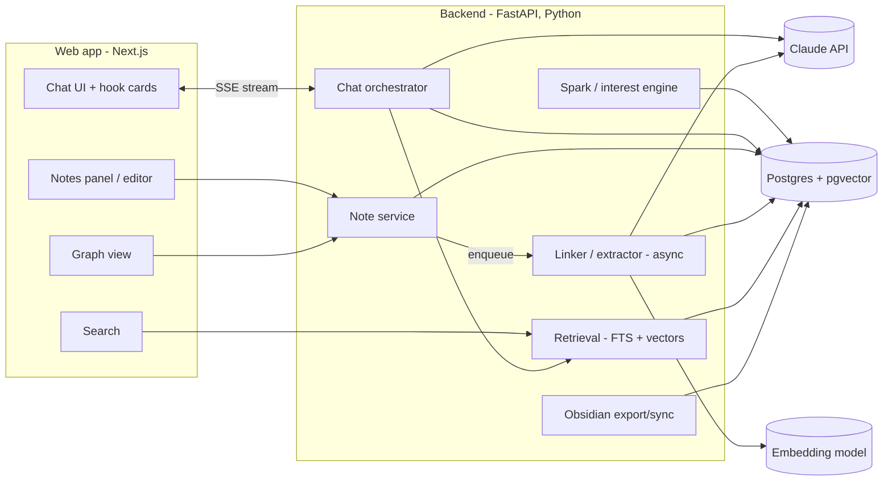

# Explore Anything — Product & Architecture Plan (v0, draft)

> A chat-first "curiosity engine": wander through concepts you don't know you're curious about,
> get hooked by concrete examples, dive or skip, and keep what matters in a linked,
> Obsidian-style knowledge graph you can always come back to.

---

## 1. Product thinking

### 1.1 The problem
- Plenty of concepts sit outside what you already know (how an air conditioner actually works,
  why bridges sway, how vaccines are made). You know the *name*, not the *mechanism*.
- You often don't know what you're curious about until you see it, so a search box doesn't help.
- Normal chats disappear. Insights aren't saved, linked or easy to find again.

### 1.2 Core loop
```
 ┌─► Spark ──► Hook ──► React ──┬─► Dive deeper ──┐
 │  (random/   (example +      ├─► Branch sideways├──► Mark/save ──► Graph grows
 │   chosen)    highlights)    └─► Skip / switch ─┘         │
 └──────────────────── "Surprise me" / resume old thread ◄───┘
```

1. **Spark**: the system suggests a concept (random, weighted by your interests) or you type one.
2. **Hook**: each answer has a fixed, skimmable shape instead of a wall of text:
   - **One-liner**: what it is, in plain words.
   - **Concrete example**: a real scene ("your AC is a refrigerator turned inside out: it moves heat out of the room, it doesn't make cold").
   - **2–3 highlights**: the "huh, interesting" facts.
   - **Bridge**: an analogy to what you already know (e.g. data science: "the thermostat is a feedback controller, like early stopping on a validation metric").
   - **Branches**: 3–4 buttons → *Go deeper* · *Related: refrigerant phase change* · *Related: heat pumps* · *Something else*.
3. **React**: dive, branch, skip or ask freely. Every reaction is also an **interest signal**.
4. **Mark**: highlight any text, or click ★ on a concept, to turn it into a **note**.
5. **Graph**: notes link up automatically ("Heat pump" ↔ "Refrigeration cycle" ↔ "Phase change" ↔ "Latent heat"), so you can browse and retrieve them later.

### 1.3 Key ideas
| Idea | What it means |
|---|---|
| **Depth dial** | Each thread has a level: *glance → explain → mechanism → expert*. "Go deeper" moves it up one step. |
| **Expertise profile** | You set it once (e.g. "strong in data science/stats"). It shapes the analogies and skips basics you already know. |
| **Interest model** | Skips, dives and saves feed a simple explore/exploit picker (basically a bandit over topic areas), so random sparks get better over time but still surprise you. |
| **Three layers** | (1) *Exploration*: threads and cards, what Claude explained. (2) *Concepts & links*: one record per concept, and links **you** draw between them to connect the dots. (3) *Insights*: **your** takeaways, ideas and questions attached to concepts. Layers 2–3 are your thinking, which a plain chat never captures. |
| **User connects the dots first** | In the MVP, links and takeaways are manual. AI-suggested links (always confirmed by you) come in P2, once we know what good links look like. |
| **Provenance** | Every note links back to the exact message(s) it came from, so you can re-enter that conversation. |
| **Obsidian-compatible** | Notes are Markdown with `[[wikilinks]]` and YAML frontmatter. You can export or sync to an Obsidian vault at any time. |

### 1.4 Main screens
1. **Explore (chat)**: thread on the left, hook cards with branch buttons, "Surprise me" button, depth indicator.
2. **Notes panel**: slide-over showing the notes made in this thread, plus backlinks.
3. **Graph view**: force-directed map of every concept you saved. Click a node to open the note or resume its thread.
4. **Library / search**: full-text and semantic search ("that thing about heat moving uphill").

---

## 2. Architecture

### 2.1 High-level diagram


### 2.2 Components
| Component | Responsibility |
|---|---|
| **Chat orchestrator** | Builds the prompt (system persona + your expertise profile + depth level + thread history + related saved notes), calls Claude, and streams back a **structured** hook card (JSON via tool use: `one_liner`, `example`, `highlights[]`, `bridge`, `branches[]`, `body_md`). |
| **Spark engine** | Picks the next random concept. It mixes (a) a topic taxonomy (physics, biology, engineering, economics, history…), (b) your interest weights, and (c) "frontier" concepts one hop away from your saved notes. Explore/exploit ratio is adjustable. |
| **Note service** | CRUD for notes. Creates a note from a highlight or a ★ click: LLM drafts a short atomic note, which you can edit. |
| **Linker (async worker)** | After a note is saved: extracts key concepts, embeds the note, finds similar existing notes, proposes `[[links]]` with a relation type (*part-of, causes, analogous-to, prerequisite, example-of*), and updates the graph. |
| **Retrieval** | Hybrid search (Postgres full-text + pgvector cosine). Used by the search screen *and* by the chat itself ("you saved *Latent heat* last week. This is the same idea.") |
| **Export/sync** | Writes notes out as `.md` files with frontmatter and wikilinks into a vault folder (one-way first, two-way later). |

### 2.3 Data model
Full P0 SQL is in [P0_SPEC.md §7](P0_SPEC.md#7-database).
```
-- layer 1: exploration
thread            (id, user_id, title, root_concept_id, current_concept_id, depth, archived, ...)
message           (id, thread_id, seq, role, action, content, card jsonb, concept_id, ...)
-- layer 2: concepts & links
concept           (id, user_id, name, slug, explored)
concept_link      (id, a_concept_id, b_concept_id, note, created_by[user|ai])
-- layer 3: insights
takeaway          (id, user_id, kind[takeaway|idea|question], body, thread_id, message_id)
takeaway_concept  (takeaway_id, concept_id)
-- signals
interest_event    (id, user_id, thread_id, concept_id, action, meta, ts)
-- later
embedding         (owner_type, owner_id, vector)    -- P2, pgvector
```

### 2.4 Tech choices (recommended)
| Layer | Choice | Why |
|---|---|---|
| Frontend | **MVP:** one static HTML/JS page served by FastAPI. **P1+:** Next.js + TypeScript + Tailwind, `react-force-graph` (or Cytoscape) for the graph | Prove the features first; real UI only for features that earn it. |
| Backend | **Python + FastAPI**, SSE streaming, background worker (arq/Celery or plain asyncio queue at first) | Your home turf (data science). Embeddings, ranking and the interest model are natural in Python. |
| LLM | **Claude API**: `claude-opus-5-5` / `claude-sonnet-5-5` for the main chat, `claude-haiku-5-5` for cheap background work (note drafting, link extraction, titles) | Quality where you read it, low cost where you don't. Structured output through tool use. Prompt caching for the system prompt and profile. |
| Embeddings | Local: `sentence-transformers` (free, offline). Cloud: a hosted embedding API (e.g. Voyage). | Claude doesn't provide embeddings. Keep a swappable interface. |
| Database | **Postgres 16 + pgvector**, run in Docker locally | Same engine locally and in the cloud (Supabase/Neon), so nothing to migrate later. Handles relational data, the graph edges (fine at personal scale), full-text search and vectors in one place. |
| Migrations | SQLAlchemy + Alembic | Standard. |

> Alternative if you want fewer moving parts: one **Next.js full-stack** app (TypeScript only) using the
> Anthropic TS SDK and Drizzle + Postgres. It's simpler to deploy, but the analytics and ML side is less pleasant. I recommend the Python backend.

### 2.5 Local → cloud path
| Stage | Setup |
|---|---|
| **Local (now)** | `docker compose up` → Postgres+pgvector, FastAPI (`uvicorn --reload`), Next.js dev server. Single user, no auth. `.env` holds `ANTHROPIC_API_KEY`. |
| **Cloud (later)** | Frontend → Vercel. API + worker → Fly.io / Render / Railway. DB → Supabase or Neon (both support pgvector). Auth → Supabase Auth or Clerk. Secrets in the platform vault. |
| **Kept portable by** | 12-factor config (env vars only), Docker images for the API, no local-file assumptions (the vault export is a feature, not the storage layer). |

### 2.6 Repo layout (proposed)
```
explore-anything/
├── apps/
│   ├── web/            # Next.js frontend
│   └── api/            # FastAPI backend
│       ├── app/
│       │   ├── routes/      # chat, notes, search, spark, export
│       │   ├── services/    # orchestrator, spark, linker, retrieval
│       │   ├── llm/         # Claude client, prompts, card schema
│       │   ├── models/      # SQLAlchemy models
│       │   └── worker.py
│       └── alembic/
├── prompts/            # versioned system prompts & card templates
├── docs/
├── docker-compose.yml
└── .env.example
```

---

## 3. Phased roadmap
| Phase | Goal | Done when |
|---|---|---|
| **P0: MVP** | Minimal UI. Hook-card chat, depth, threads; concepts with **manual links**; **takeaways/ideas/questions**; Claude sees your notes. See [P0_SPEC.md](P0_SPEC.md) | You explore, connect and annotate concepts for a week and actually keep using it |
| **P1: Polish** | Real frontend (Next.js) for the features that proved useful, graph view, Markdown/Obsidian export | Concepts, links and takeaways export cleanly as an Obsidian vault |
| **P2: Assist** | Embeddings, AI-**suggested** links (you confirm), hybrid search | Suggestions are accepted often enough to be worth it; search by meaning works |
| **P3: Wander** | Spark engine + interest model, "Surprise me", frontier suggestions, chat recalls your past notes | Random sparks noticeably follow your taste and still sometimes surprise you |
| **P4: Cloud** | Deploy, auth, backups, mobile-friendly UI | Usable from your phone |
| **P5: Extras** | Two-way Obsidian sync, spaced "revisit" prompts, diagrams/images in cards, voice | — |

---

## 4. Open questions (to settle before details)
1. ~~**Obsidian itself vs. built-in notes**~~ **Decided (2026-10-25):** notes live in the app's database as the source of truth, with Markdown export (later sync) to an Obsidian vault.
2. **Single user or multi-user**: just you, or eventually others (friends, public)? This affects auth and data isolation from day one.
3. **Stack**: OK with Python backend + Next.js frontend, or would you rather have a single TypeScript app?
4. **Hook card strictness**: always the structured card, or only for the first answer on a concept, with free-form replies after that?
5. **Spark sources**: only LLM-generated concepts, or also seed from Wikipedia "random article" / curated lists?
6. **Budget**: rough monthly LLM spend you're comfortable with (this decides which model handles the main chat by default).
